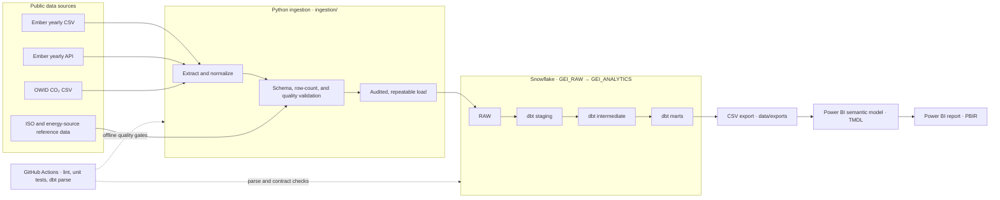
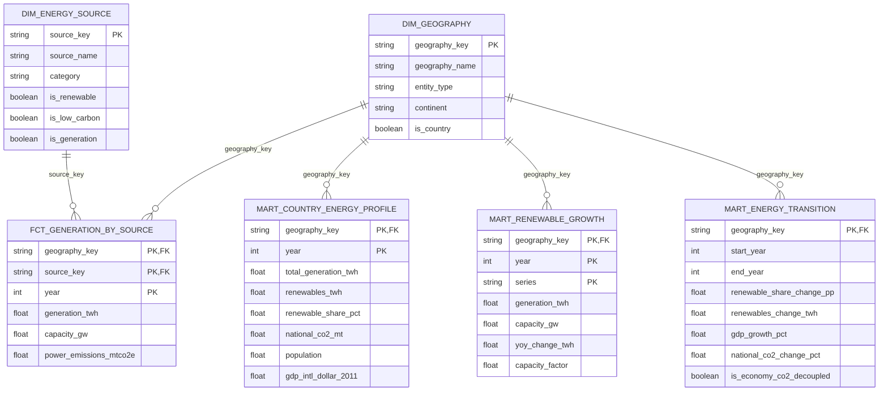

# Global Energy Intelligence

An end-to-end analytics project exploring how electricity generation is changing, where renewable energy is
growing, and how the transition relates to economy-wide emissions and economic development.

The project turns public electricity and emissions data into reproducible, tested analytical tables and a
Power BI report. Its engineering is production-minded: data contracts, explicit quality checks, auditable loads,
isolated CI, documented operations, and a local CSV path that does not require live warehouse access.

> **Interpretation:** results are descriptive or associational, not causal. Ember's latest years are estimates.
> Power-sector lifecycle emissions and OWID territorial CO₂ are different measures and must not be compared as
> if they were equivalent.

## What this project does

- Ingests Ember yearly electricity data (CSV and API) and Our World in Data (OWID) CO₂ data.
- Validates source schemas and loaded row counts before data can be used downstream.
- Transforms raw data through Snowflake and dbt into geography, source, generation, country-profile, renewable
  growth, and transition-analysis models.
- Exports six reporting tables as CSV and uses them in a version-controlled Power BI Project.
- Supports analysis of world trends, country energy mix, renewable capacity and growth, transition leaders, and
  emissions/economy associations.

## Architecture



### Analytics model

The diagram shows the report-facing star schema. Dimension filters flow one way to the related facts. The
transition mart represents the 2010–2022 comparison window; it is not an annual time series.



## Findings at a glance

The following are documented reference results computed from the checked-in exports; refresh and compare them
before publishing a new data vintage. The detailed narrative and caveats are in
[docs/findings.md](docs/findings.md).

- Ember's World generation rose from **15,325.3 TWh in 2000** to **29,788.6 TWh in 2023**. The renewable
  generation share increased from **18.7% to 30.0%** over the same years.
- In 2023, China generated **9,402.74 TWh** with a **30.0%** renewable share; the United States generated
  **4,253.91 TWh**, with a **22.7%** renewable share and **59.1%** fossil share.
- China, the United States, India, Brazil, and Germany led absolute renewable growth over 2010–2022.
  Share-based rankings tell a different story, so the report includes both absolute growth and total-generation
  change.
- In the 2010–2022 transition window, **148 of 208** countries were eligible for comparison and **48** showed
  GDP growth alongside falling national CO₂. This is an association, not evidence that one caused the other.

## Data sources and interpretation

| Source | Used for | Licence / caveat |
|---|---|---|
| [Ember Yearly Electricity Data](https://ember-energy.org/data/yearly-electricity-data/) | Generation, capacity, demand, net imports, and power-sector emissions | CC-BY-4.0; latest years are estimates; lifecycle emissions |
| [OWID CO₂ and GHG emissions](https://github.com/owid/co2-data) | National CO₂, population, GDP, and primary energy | CC BY 4.0 for OWID-produced content; third-party terms also apply |
| `data/reference/` | Geography and energy-source reference data | Maintained in this repository |

Important modeling rules:

- Use Ember's `REG_WORLD` rows for world totals; **do not sum country rows** to recreate the World.
- Generation shares use generation, not electricity consumption. Bioenergy is renewable under Ember's convention.
- An absent generating-source row is treated as zero only where the other source rows reconcile to Ember's published
  total. Other missing measurements remain null; null is not zero.
- OWID national CO₂ is territorial/economy-wide, while Ember power-sector emissions are lifecycle CO₂e.
- GDP data ends in 2022; the transition comparison therefore uses a 2010–2022 window.
- See [docs/data_sources.md](docs/data_sources.md) and
  [docs/business_logic/metrics.md](docs/business_logic/metrics.md) for definitions and provenance.

## Quick start

### Requirements

- Python **3.12 or 3.13**
- [uv](https://docs.astral.sh/uv/)
- For warehouse ingestion/builds only: access to the configured Snowflake account and credentials
- For the dashboard: Power BI Desktop on Windows (or use the exported CSVs with a compatible Power BI setup)

### Install and run offline checks

```bash
uv sync --frozen
uv run ruff check ingestion tests dbt/run_dbt.py
uv run pytest -q
```

Validate a source file without Snowflake:

```bash
uv run python -m ingestion.cli ember_yearly_csv --dry-run
```

`--dry-run` validates the local source without loading it. To download and load a source, see the
[operations runbook](docs/operations.md). Never commit `.env`, private keys, or credentials.

### Build and refresh

The data pipeline requires a configured Snowflake profile. Set up the account using
[docs/snowflake_setup.md](docs/snowflake_setup.md), then follow the documented refresh procedure:

```bash
uv run python dbt/run_dbt.py build --target prod
uv run python -m ingestion.export
```

The exported CSVs in `data/exports/` make the report usable without a live Snowflake connection. The real
Snowflake build workflow is manual and uses an isolated CI schema; routine GitHub Actions checks do not need
Snowflake credentials. See [docs/operations.md](docs/operations.md) for load recovery, quality gates, and
refresh details.

### Open the Power BI report

Open [powerbi/GEI.pbip](powerbi/GEI.pbip) in Power BI Desktop. If the CSV source path is incorrect, set the
`ExportsFolder` parameter to the full local path of `data/exports\` (including the trailing backslash), refresh,
and compare key metrics with [the report specification](docs/powerbi/report_spec.md).

The PBIP has been confirmed to open in Desktop. Visual rendering and the listed DAX results still need to be
reviewed against the expected values before treating a refreshed report as release-ready. See
[powerbi/README.md](powerbi/README.md) for details.

## Data dictionary

The complete field-level dictionary for all six exported tables is in
[docs/data_dictionary.md](docs/data_dictionary.md). It documents each table's grain, key fields, units, and
null/percentage conventions.

## Skills demonstrated

| Area | Skills applied in this project |
|---|---|
| Data engineering | API and CSV ingestion, schema contracts, normalization, idempotent loads, row-count reconciliation, failure handling |
| Analytics engineering | dbt staging/intermediate/mart layers, dimensional modeling, grain and key design, tests, freshness and metric rules |
| Cloud data platforms | Snowflake role separation, least-privilege CI access, environment-based credentials, isolated build schemas |
| Python development | Typed/configured package workflows, reusable CLI modules, linting, unit tests, secure secret handling |
| BI and analytics | DAX measures, TMDL/PBIR project structure, geographic maps, time slicers, metric interpretation, dashboard validation |
| DevOps and governance | GitHub Actions, offline CI, manual gated warehouse workflow, reproducible dependency lock, runbooks, decision records |
| Communication | Mermaid architecture and ER diagrams, data dictionary, documented findings, provenance and analytical limitations |

## Production-minded quality and project status

| Control or deliverable | Implementation / status |
|---|---|
| Source contracts | Headers and expected row counts are checked; invalid or incomplete loads are rejected |
| Transformation quality | dbt tests protect keys, relationships, accepted values, and headline reconciliation rules |
| Repeatability and audit | Loads are recorded; a failed load is not promoted as the latest successful data |
| Continuous integration | GitHub Actions runs lint, unit tests, and `dbt parse` without Snowflake secrets |
| Warehouse CI safety | Snowflake workflow is manual, reviewer-gated, and builds in throwaway schemas |
| Operations | Refresh, warnings, recovery, and post-trial behavior documented in [docs/operations.md](docs/operations.md) |
| Dashboard | PBIP opens in Power BI Desktop; a full render and metric sign-off remain outstanding |
| Findings | Reference metrics are written up in [docs/findings.md](docs/findings.md) |

This is a portfolio-scale project with production-style controls, not a claim of a continuously operated
production service. Refresh orchestration and alerting are deliberately out of scope; see the runbook and
[design decisions](docs/decisions/adr-log.md).

## Repository layout

```text
data/                   Public source files, reference data, and reporting exports
ingestion/              Python extract, validate, load, and export modules
dbt/                    Staging, intermediate, and mart transformations
powerbi/                PBIP report, semantic model, visuals, and theme
tests/unit/             Offline Python and repository-contract tests
docs/                   Sources, metrics, architecture context, operations, and findings
infra/                  Snowflake setup and cleanup SQL
.github/workflows/      Offline CI and manual Snowflake build
notebooks/legacy/       Original exploratory notebook, preserved for context
```

## Documentation

- [Data sources and provenance](docs/data_sources.md)
- [Metric definitions and modeling rules](docs/business_logic/metrics.md)
- [Field-level data dictionary](docs/data_dictionary.md)
- [Findings summary](docs/findings.md)
- [Operations runbook](docs/operations.md)
- [Snowflake setup](docs/snowflake_setup.md)
- [Power BI model and rules](docs/powerbi/model.md)
- [Report specification and expected results](docs/powerbi/report_spec.md)
- [Architecture decisions](docs/decisions/adr-log.md)
