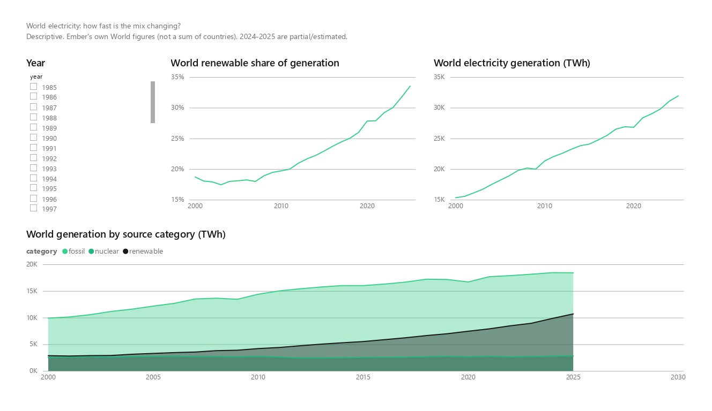
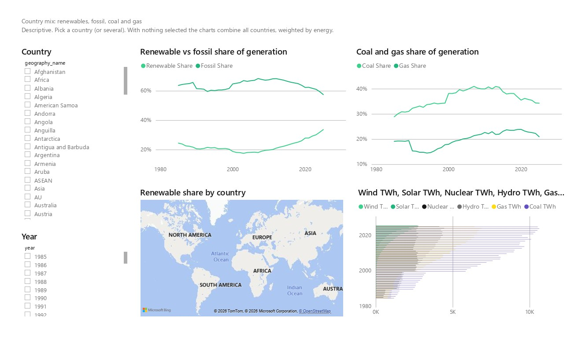
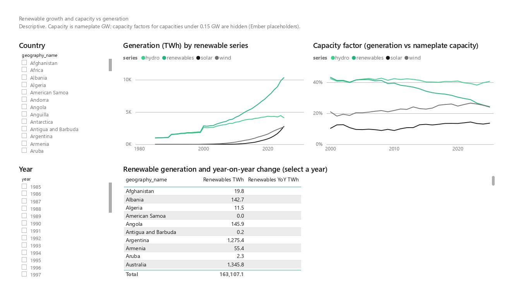
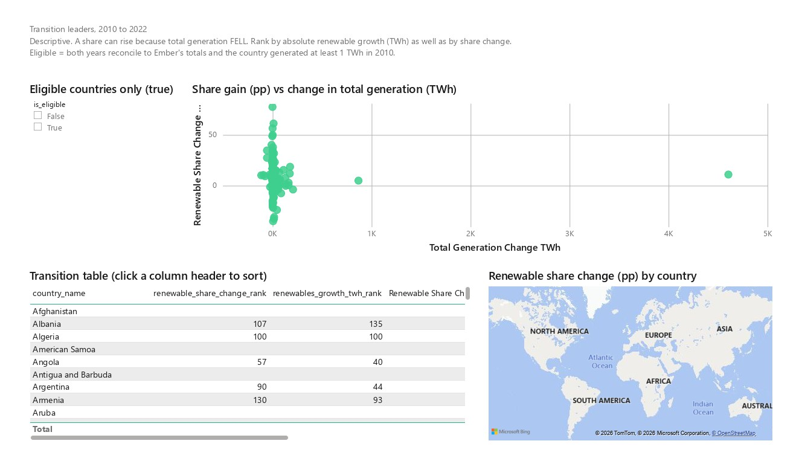
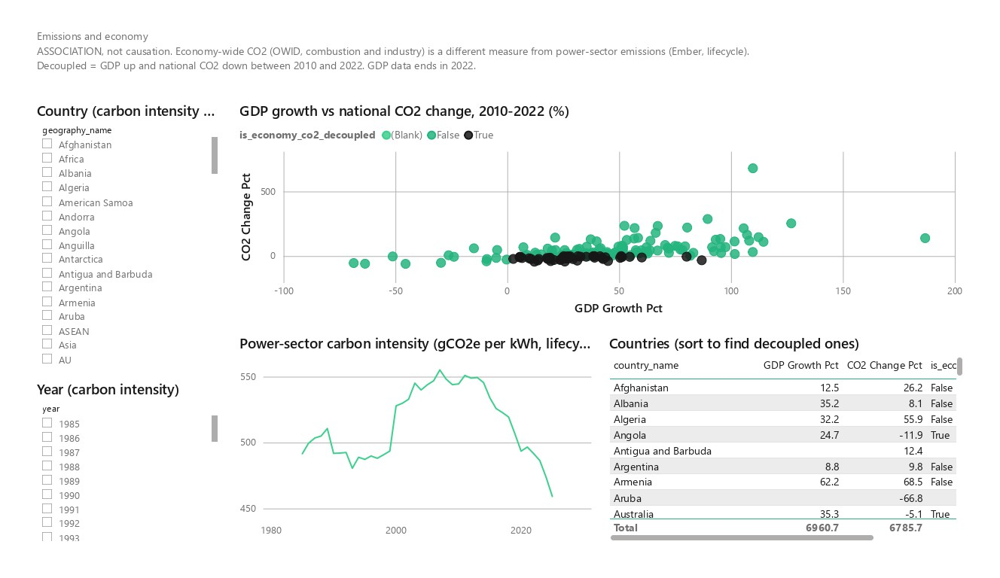

# Power BI dashboard (PBIP)

`GEI.pbip` is the dashboard for the Global Energy Intelligence Pipeline, saved as a **Power BI Project**: plain text
files instead of a binary `.pbix`, so the model and the report can be diffed and reviewed in git. It reads the six
CSV files in [`data/exports/`](../data/exports/) (written by `python -m ingestion.export` from the production marts),
so it needs **no Snowflake connection** and keeps working after the Snowflake trial ends.

Status on 2026-11-06: the project opens in Power BI Desktop, and a PDF export from Desktop shows all six pages
rendering. A few visuals do not yet look right (see [Known issues](#known-issues-seen-in-the-pdf-export)), and the
numbers have only been checked by eye so far (see [What has been checked](#what-has-been-checked)).

## What is in the project

```
GEI.pbip
GEI.SemanticModel/   TMDL model: 6 tables, 5 relationships, 31 explicit measures, 1 parameter (ExportsFolder)
GEI.Report/          PBIR report: 6 pages, 30 visuals, custom theme "GEI-Emerald"
```

| Model table | Source CSV | Grain |
|---|---|---|
| `dim_geography` | `dim_geography.csv` | one row per country or region (World, EU, ...) |
| `dim_energy_source` | `dim_energy_source.csv` | one row per electricity-source label |
| `fct_generation_by_source` | `fct_generation_by_source.csv` | geography x year x source |
| `mart_country_energy_profile` | `mart_country_energy_profile.csv` | country x year |
| `mart_renewable_growth` | `mart_renewable_growth.csv` | country x year x series (solar, wind, hydro, renewables) |
| `mart_energy_transition` | `mart_energy_transition.csv` | country (one 2010-2022 window) |

All measures are explicit DAX measures (the model discourages implicit ones). Shares are computed from sums, never
as an average of country percentages. See [`docs/powerbi/model.md`](../docs/powerbi/model.md) for the relationships
and the rules that keep the numbers correct, and [`docs/powerbi/measures.dax`](../docs/powerbi/measures.dax) for
the measure definitions.

## Open it

1. Power BI Desktop (Windows, a current release): **File > Open report > Browse** and pick `powerbi/GEI.pbip`.
2. If the data fails to load: **Home > Transform data > Edit parameters** and set `ExportsFolder` to the full path of
   `data\exports\` on your machine. It must end with a backslash. The default points at the author's checkout.
3. **Refresh**, then save. From the first save on, Power BI Desktop owns these files: edit in Desktop, not by hand.
4. Close Desktop before switching git branches. Windows will not let git replace files that Desktop has open.

If Desktop reports an error when opening, it names the file. A report error usually points at one
`GEI.Report/definition/pages/<page>/visuals/<name>/visual.json`: remove that visual folder, open the rest, and
re-create the visual in the UI. A model error names a `.tmdl` file under `GEI.SemanticModel/definition/`.

## Pages

| # | Page | Answers | What is on it |
|---|---|---|---|
| 1 | World overview | How is the world mix changing? | World renewable share and generation by year, generation by source category. Uses Ember's own World figures, never a sum of countries. |
| 2 | Country mix | Renewables, fossil, coal and gas by country | Country and year slicers, renewable vs fossil share, coal and gas share, generation by source, a renewable-share map. |
| 3 | Renewable growth | Capacity vs generation | Solar, wind, hydro and total renewables by year, capacity factor, and a table of renewable generation and year-on-year change. |
| 4 | Transition leaders | Who progressed most, 2010-2022? | Eligible-country filter, share gain vs change in total generation, a ranking table (by share change and by absolute TWh), a map. |
| 5 | Emissions and economy | Growth alongside falling emissions? | GDP growth vs national CO2 change (labelled an **association**), power-sector carbon intensity, a country table. |
| 6 | Data notes | Limitations | The caveats below, as text. |

Each page states whether it is descriptive or an association. Caveats that apply everywhere: 2024 covers 194 countries
and 2025 only 94, and Ember's latest years are estimates; shares are shares of generation, not consumption; Ember's
power-sector emissions are lifecycle figures and OWID's national CO2 is combustion only, so they are not comparable;
GDP ends in 2022, which is why the transition window is 2010-2022.

## Screenshots

Exported from Power BI Desktop on 2026-11-06 (page 6, Data notes, is plain text and is not shown). The two maps are
empty in this export; see [Known issues](#known-issues-seen-in-the-pdf-export).

**1. World overview**



**2. Country mix**



**3. Renewable growth**



**4. Transition leaders**



**5. Emissions and economy**



## What has been checked

| Check | Status |
|---|---|
| Report JSON validates against Microsoft's published JSON schemas | done for the original report; the later map and slicer changes parse but were not schema-validated |
| Format versions match what this Desktop release writes (`version.json` 2.0.0, page 2.1.0, pages 1.1.0, report 3.3.0) | done; the first version used older formats and failed to open |
| The model loads in Desktop (all tables and the parameter appear in its diagnostics) | done |
| The report opens in Desktop | done: confirmed on 2026-11-06 |
| All six pages render | done: a PDF export from Desktop (`GEI.pdf`) shows them |
| Page 1 values against the expected ones | **read by eye only**: renewable share about 19% in 2000 and about 30% in 2023, generation about 15,300 TWh in 2000 and about 29,800 TWh in 2023, consistent with the expected 18.7%, 30.0%, 15,325 and 29,789 |
| Slicer-driven numbers (for example US 2023: 4,253.91 TWh, 22.7% renewable) | **not yet checked**: select the country and year and compare with the table in [`docs/powerbi/report_spec.md`](../docs/powerbi/report_spec.md) |

## Known issues seen in the PDF export

These are observations from the 2026-11-06 export, not fixes. The causes below are hypotheses, not confirmed.

1. **Both maps are empty** (page 2 "Renewable share by country", page 4 "Renewable share change by country"): only the
   base map shows, with no coloured countries. Both bind `country_name` as the location. Check that the column's data
   category is Country/Region and that Bing map data is allowed, or compare with a PDF made from the live report.
2. **Page 2 "Generation by source"** is a clustered bar chart with the year on the vertical axis and about 40 thin
   bars. It also shows an automatic title ("Wind TWh, Solar TWh, ...") because no title is set on it. A stacked column
   chart by year was the original design.
3. **Page 3 table without a year selected**: the "Total" row (about 163,107 TWh) and each country figure are sums over
   all years, which is not a meaningful quantity, and "Renewables YoY TWh" is blank until a year is selected. The title
   says to select a year; the table should also say what the sums are.
4. **Total rows on percentage tables**: on page 5 the Total row adds up percentages (6,960.7 and 6,785.7), which is
   meaningless. Turn off the total row on the page 3, 4 and 5 tables or replace it with a count.
5. **Cosmetic**: the page 1 area chart axis runs to 2030 while the data ends in 2025; on page 4 China's +4.6K TWh
   compresses every other point in the scatter plot.

## Power BI Modeling MCP (optional)

Microsoft's server (`@microsoft/powerbi-modeling-mcp`, MIT, maintained by Microsoft) was used to reload the semantic
model from the TMDL folder. It can edit and query the model (tables, columns, measures, relationships, DAX) of a model
open in Desktop or a TMDL folder. It **cannot** change report pages or visuals, so it cannot fix the issues above.
Its tools appear only in a new Claude Code session, its EULA must be accepted by you (it blocks every tool until you
do), and it collects usage data for Microsoft and may self-update.
